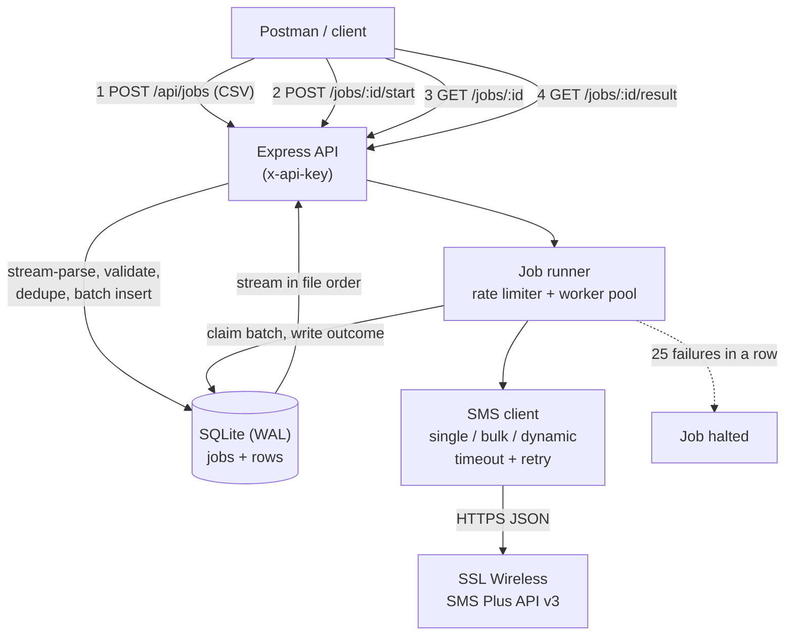

# SMS Coupon Sender - Architecture (v2, sized for 100k-200k recipients)

## 1. Requirements

**Functional**
- Upload a CSV with `contact_no`, `outlate_name`, `cupon_code`, `stage` (stage is optional and only carried through) through an HTTP API.
- Send one SMS per recipient (outlet name and coupon id) through the SSL Wireless SMS Plus API.
- Produce a result CSV: `contact_no`, `stage`, `status` (SENT / FAILED / SKIPPED / UNKNOWN ...), `response` (the row's API + `smsinfo` result as compact JSON), `message`, `sending_time`.
- Postman collection and environment.

**Non-functional**
| Area | Target |
|---|---|
| Volume | 100,000 to 200,000 rows per file |
| Duration | Depends on the SSL Wireless rate limit and the send mode, not on this service (the storage path does about 3,800 rows/s). `dynamic` with `BATCH_SIZE=100` is up to 100x the per-request rate |
| Reliability | Survive a crash or restart mid-run without losing results and **without sending anyone a second SMS** |
| Cost safety | A wrong template or bad credentials must not burn through 200k messages |
| Memory | Flat, independent of file size (about 150 MB measured at 200k rows) |
| Security | API key on all routes; SSL credentials only in env vars |
| Operations | One Node process, one SQLite file, no external services |

**Out of scope**: multiple instances, delivery reports (DLR) callbacks, user accounts, UI.

## 2. Time to send (the number that matters)

| Allowed rate | 100k rows | 200k rows |
|---|---|---|
| 5 per second | 5.6 h | 11.1 h |
| 10 per second | 2.8 h | 5.6 h |
| 50 per second | 33 min | 67 min |
| 100 per second | 17 min | 33 min |

Ask SSL Wireless for the highest rate and concurrency your account allows (and the batch size of their dynamic endpoint, see ADR-002), then set `RATE_PER_SECOND` and `CONCURRENCY`.

## 3. Architecture

**Row life cycle**: `pending` -> `sending` -> `sent` | `failed` | `unknown`. Rows that are invalid or duplicated are `skipped` at upload. Dry runs end as `dry_run`.

**Job life cycle**: `loading` -> `ready` -> `running` -> `completed` | `cancelled` | `halted` | `failed`. A `halted` job can be started again and continues with the remaining rows.

### Send modes

`SMS_MODE` picks the endpoint (spec: [ssl-push-sms-api-v3.md](ssl-push-sms-api-v3.md)). The choice is stored on the job,
so a resumed run keeps the same request shape.

| Mode | Endpoint | One request carries | Notes |
|---|---|---|---|
| `single` | `/api/v3/send-sms` | 1 SMS | Default; one HTTP call per row |
| `bulk` | `/api/v3/send-sms/bulk` | up to 100 numbers, one shared body | Only rows that render to the *same* text share a request, so a per-recipient coupon template stays at one number per call |
| `dynamic` | `/api/v3/send-sms/dynamic` | up to 100 numbers, each with its own body | Best fit here: each coupon message differs |

`RATE_PER_SECOND` counts requests, not SMS, so a batching mode sends up to `BATCH_SIZE` times more SMS
per second (the gateway caps a bulk/dynamic request at 100 numbers, and `BATCH_SIZE` is clamped to it).

Replies are mapped back per row: single and dynamic by `csms_id`, bulk by `msisdn` (a bulk reply
repeats one `batch_csms_id` for the whole request). Each row's `response` is a compact JSON object with
the API result and its own `smsinfo` entry.

## 4. Decisions (ADRs)

### ADR-001: Two-step flow: upload (validate) then explicit start
- **Status**: Accepted (changed from v1, where upload started sending immediately)
- **Context**: At 200k messages a wrong template or wrong column is expensive and irreversible once sending begins.
- **Decision**: Upload only loads and validates the file and returns counts, a preview of the first 3 texts, and an estimated duration. Sending begins only after `POST /start` with an explicit `{"dry_run": true|false}`.
- **Consequences**: (+) A review point before spending money; accidental real sends are harder. (-) One more API call.

### ADR-002: Support all three documented endpoints, selected by `SMS_MODE`
- **Status**: Accepted (implemented after the v3.0.0 specification was obtained)
- **Context**: Each row has different text and the result needs a response per number. The specification documents three endpoints - single, bulk (same text) and dynamic (different text per number) - with a limit of 100 MSISDN per bulk/dynamic request. The earlier version used the single endpoint only because the limits were not yet known.
- **Decision**: Implement all three. `SMS_MODE` selects the endpoint, `RATE_PER_SECOND` and `CONCURRENCY` pace it, and the runner batches up to `BATCH_SIZE` rows per request in the bulk/dynamic modes. `bulk` only groups rows whose rendered text is identical, so the per-recipient coupon template effectively stays at one number per call.
- **Consequences**: (+) Exact per-row responses, safe retries with a stable `csms_id`, and dynamic mode raises throughput up to 100x for the same request rate. (-) One combined response must be mapped back to rows (by `csms_id` for single/dynamic, by `msisdn` for bulk); `RATE_PER_SECOND` changes meaning from SMS/s to requests/s.

### ADR-003: SQLite instead of in-memory data and flat files
- **Status**: Accepted (changed from v1 files)
- **Context**: 200k rows need per-row state, crash recovery, ordered export and constant memory. Flat files cannot be updated per row and in-memory state is lost on restart.
- **Decision**: One SQLite database in WAL mode (`jobs`, `rows`). Upload is stream-parsed and inserted in batches of 2,000; results are streamed out in file order.
- **Alternatives**: PostgreSQL or Redis queues are stronger but add servers to run for a single-purpose batch tool. Flat CSV cannot support resume.
- **Consequences**: (+) Durable, queryable, no extra infrastructure. (-) Single writer: run one instance only.

### ADR-004: Crash recovery never resends uncertain messages
- **Status**: Accepted
- **Context**: If the process dies while a request is in flight, we cannot know whether SSL Wireless accepted it. Resending risks a duplicate SMS to a customer; not resending risks a missed one.
- **Decision**: Each row is marked `sending` before the request. On startup, rows still `sending` become `unknown` and are **not** resent; `pending` rows continue automatically (`AUTO_RESUME`). Each SMS carries a unique `csms_id` (job prefix + row number).
- **Consequences**: (+) No automatic duplicates (verified: a forced kill produced 10 `unknown` rows and zero repeated requests). (-) A few rows per crash need a manual check in the SSL Wireless panel.

### ADR-005: Circuit breaker on consecutive failures
- **Status**: Accepted
- **Context**: Wrong token, empty balance or a blocked sender id fails every message, and a 200k job would otherwise grind through all of them.
- **Decision**: After `CONSECUTIVE_FAILURE_LIMIT` (default 25) failures in a row the job becomes `halted` with the last response as the reason. Fix the cause, then call `/start` again to continue.

### ADR-006: Block re-uploading a file that was already sent
- **Status**: Accepted
- **Decision**: The file's SHA-256 is stored. Uploading identical content again returns `409` with the earlier job id unless `force=true`. Rows duplicated inside one file (same number and coupon) are skipped.
- **Consequences**: Protects against the most likely human error at this scale: sending the same list twice.

### ADR-007: Retries only for transient errors, with the same `csms_id`
- **Status**: Accepted (unchanged)
- **Decision**: Network errors, timeouts and 5xx retry twice with backoff. Clear API rejections are not retried. Whether SSL Wireless rejects a repeated `csms_id` should be confirmed with them.

### ADR-008: Static API key authentication
- **Status**: Accepted (unchanged). `x-api-key`, constant-time comparison, SSL credentials only in environment variables.

## 5. Risks and mitigations

| Risk | Impact | Mitigation |
|---|---|---|
| SSL Wireless rate limit lower than expected | Job takes 11+ hours | Confirm the limit first; raise `RATE_PER_SECOND` only up to what they allow |
| Account throttling or blocking at high volume | Many failures | Circuit breaker halts the job; resume after SSL confirms |
| Crash during a request | A few uncertain rows | Marked `unknown`, never auto-resent; check the SSL panel |
| Same list sent twice | Double cost, annoyed customers | File-hash block (409), in-file duplicate skip, mandatory dry run option |
| Server stopped for hours (laptop sleep, reboot) | Job stalls | Run on a server with a process manager (systemd or pm2); `AUTO_RESUME` continues on restart |
| Wrong template at scale | 200k wrong SMS | Preview before start, small test file first, cancel endpoint |
| Bangla or Unicode text splits into more SMS parts | Higher cost | Test the template on a real handset first |
| Content or sender-id rules (BTRC, operator masking, DND) | Messages blocked | Confirm the sender id and message content are approved with SSL Wireless |
| Disk growth | Database size | About 200 bytes per row, so 200k rows is a few tens of MB |
| Single instance only | No horizontal scaling | Acceptable for this workload; revisit if volume grows by 10x |
